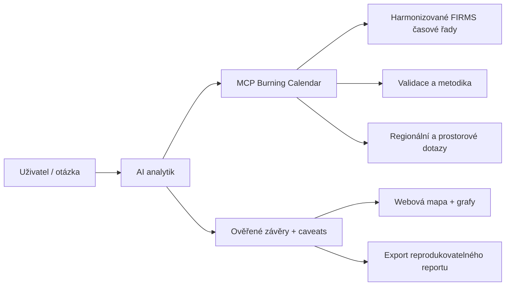

# Review 14 Nov 2026: scientific review and hackathon plan (pasted, Czech)

Pasted into a Claude Code session on 14 Nov 2026. Author: an outside AI assistant that queried the production MCP server on 14 Nov 2026; not written by the team. Original text below, unchanged.

## Check against the repo on 14 Nov 2026 (Claude Code)

- Numbers match [../findings-greece.md](../findings-greece.md): GR LOYO 5.4 %, time split 7.1 %, 2023 +22.9 %, EL52 4.0 / 11.7 %, EL62 relative 32.0 / 40.5 %.
- Outdated: the document lists 10 MCP tools and says there is no current data. Production has 15: also `show_calendar` (MCP Apps widget) and four live context tools `get_fire_alerts`, `get_fire_weather`, `get_weather_stations`, `get_recent_detections` (decisions.md, 14 Nov). The harmonized series still ends Dec 2025.
- Conflicts with [../personas.md](../personas.md) and [../decisions.md](../decisions.md): it names researchers and journalists as users (journalist is not a persona; primary is the early warning analyst) and proposes "AI Fire Investigator" as the product direction, while decisions give agent access one slide and about 20 s of live demo, with the demo opening on Paraná 2020.
- Its demo pair works on the MCP (checked 14 Nov 2026): peak month EL61 Thessalia 7 (July), EL52 Kentriki Makedonia 10 (October); density EL61 81.95, EL52 59.57 detections per 1000 km² per year, both harmonized, `ranking_allowed: true`. Density includes back-cast years without a back-cast caveat (open bug burncal-k9p).
- Proposals not built: evidence panel, caveat badges in a chat UI, Markdown report export, AOI polygons. Deep links, CSV export and caveats in every MCP response exist.

---

Burning Calendar — vědecký review a hackathonový plán
Datum: 14. 11. 2026
Projekt: https://burning-calendar.vercel.app/
Účel dokumentu: Zadání pro tým a AI asistenty pracující s MCP serverem; kritické zhodnocení, use cases, priority implementace a scénář demonstrace.

1. Executive summary
Burning Calendar je mapová a analytická aplikace pro historickou aktivitu požárů v Řecku a Argentině. Největší výhodou není samotná mapa, ale harmonizovaná časová řada NASA FIRMS a její přístupnost přes nástroje MCP. Pro hackathon doporučujeme produktový směr Explainable GeoAI / AI Fire Investigator: uživatel položí přirozenou otázku, AI použije přes MCP skutečná data, provede srovnání, otevře správnou mapu a vytvoří stručné, reprodukovatelné vysvětlení s omezeními a nejistotou.

Jednovětý pitch: „Burning Calendar transforms decades of satellite fire detections into transparent, verifiable geospatial insights through a natural-language AI analyst.“

Základní rozhodnutí: Dodat jeden výborně fungující end-to-end scénář, nikoliv deset rozpracovaných funkcí.

2. Ověřený stav dat a metodiky MCP
- Geografie: Řecko (země a 13 regionů NUTS2), Argentina (země a 24 provincií).
- Časový rozsah: listopad 2000 – prosinec 2025. Nejde o aktuální monitorování a rok 2026 zatím není pokrytý.
- Zdroj: NASA FIRMS, MODIS C6.1 (Terra + Aqua), VIIRS S-NPP 375 m.
- Počítaná veličina: satelitní detekce aktivního ohně, ne počet unikátních požárů ani spálená plocha.
- Metoda: od roku 2012 pozorované počty VIIRS; starší měsíce jsou MODIS převedené na ekvivalent VIIRS pomocí koeficientů kalibrovaných pro region, kalendářní měsíc a den/noc v překryvném období 2012–2019.
- Filtrace: předpokládané vegetační požáry; odstranění statických zdrojů v buňkách 0,01° s alespoň 16 detekčními dny za rok.
- Nejistota: historický back-cast před rokem 2012 je modelovaný, včetně intervalů nejistoty; některé regiony mají pouze relative mode a nejsou přímo porovnatelné podle absolutních počtů.
- Limity: neměnné korekční faktory nereflektují změny land cover, satelitní výpadky ovlivňují pozorování, data UTC mohou posouvat lokální datum (zejména Argentina), známý problém Aqua srpen–září 2020. Podle MCP není hotové navázání na NOAA-20 po ukončení S-NPP 2. 11. 2026.

Validace: příklad Řecko
- LOYO (leave-one-year-out, 2012–2019): medián absolutní roční procentní chyby 5,4 %.
- Time-split (trénink 2012–2019, test 2020–2025): medián absolutní roční procentní chyby 7,1 %.
- V testu pro rok 2023: procentní chyba +22,9 %; pozor, celostátní dobrá metrika nezaručuje přesnost v každém roce nebo regionu.
- Regionální příklady: střední Makedonie (EL52) LOYO 4,0 %, test 11,7 %; Iónské ostrovy (EL62) jsou v relative mode, LOYO 32 %, test 40,5 %.
- Harmonizace se proto nesmí bez podmínek prezentovat jako bezchybná rekonstrukce historie.

Existující MCP nástroje (ověřeno z rozhraní)
| Nástroj | Funkce | Příklad použití |
|---|---|---|
| search_regions | Vyhledání zemí/regionů, režim, odkazy na mapu | „Najdi Thesálii“ |
| find_region_at | Určení regionu podle souřadnic | Kliknutí do mapy → region |
| get_region_series | Měsíční/roční počty, intervaly, anomálie, exporty | Vývoj v čase |
| get_season_calendar | Nástup, konec, délka a vrchol sezóny | Sezónní profil |
| get_anomalies | Měsíční odchylky vůči předchozím 10 rokům | Výjimečné měsíce |
| compare_regions | Srovnání 2–10 regionů | Porovnání Thessálie/Makedonie |
| aggregate | Agregace 1–40 regionů za období | Souhrn oblastí |
| rank_regions | Žebříčky, zejména na 1 000 km² | Hustota detekcí |
| get_validation | Validace harmonizace, chyby, důvody režimů | Vědecká obhajoba |
| get_methodology | Metodika, caveats, limity | Citace a vysvětlení |

Poznámka: Zdrojové MCP rozhraní vrací mapové a datové URL, u Řecka také CSV jednotlivých hotspotů. Některé regiony jsou vyřazeny z absolutního rankingu; respektovat ranking_allowed, excluded_relative a návratové caveats.

3. Kritická analýza
Silné stránky
1. Dlouhá časová řada a harmonizace dvou generací senzorů.
2. Transparentní validace a možnost vyčíslit nejistotu.
3. Regionální sezónnost, anomálie a porovnávání, už dostupné přes MCP.
4. Propojení GIS, DPZ a AI umožňuje vědecky interpretovatelná uživatelská zadání.
5. Strojově dostupná data a exporty podporují reprodukovatelnost.

Slabiny a rizika
1. Aktuálnost: bez roku 2026 není produkt real-time wildfire monitor.
2. Význam metriky: detekce ≠ požár ≠ spálená plocha ≠ pravděpodobnost budoucího požáru.
3. Modelová nejistota: validace v celku zakrývá rozdíly mezi roky a regiony.
4. Prostorové omezení: dotazy jsou primárně předdefinované administrativní jednotky, ne libovolné AOI.
5. Příčinné závěry: ze samotných hotspotů nelze prokázat příčinu (sucho, zemědělství, klima, lidská činnost).
6. Konkurenceschopnost: mapa, grafy nebo generický chatbot samy o sobě nejsou unikátní produkt.
7. UX: je třeba zřetelně odlišit měřená data, modelovaný back-cast, relativní srovnání a hypotézy.

Rozsah ověření: Metodika a MCP funkce byly prověřeny přímo. Detailní vizuální UX/a11y/performance audit webu nebyl proveden, proto o vzhledu a konkrétních vadách UI nelze dělat definitivní závěry.

4. Možnosti použití
A. AI Fire Investigator — P0, doporučený koncept
- Přirozená otázka → výběr nástrojů MCP → výsledky → mapa/graf → stručná interpretace.
- Každé tvrzení opřít o region, období, metriku, výsledek konkrétní funkce a nejistotu.
- Příklad: „Jak se liší průběh požární sezóny ve střední Makedonii a Thesálii?“
- Užitek: výzkumníci, novináři, veřejná správa, studenti.
B. Seasonality Planning — P1
- Plánování období pro monitoring a kapacity podle historicky pozorované aktivity.
- Pozor: nejde o předpověď aktuálního rizika ani automatické operační doporučení.
C. Scientific Research Assistant — P1
- Výzkumné grafy, metadata, metodika, intervaly nejistoty a export CSV/JSON.
- Reprodukovatelný report včetně volaných MCP funkcí a parametrů.
D. Custom Area of Interest — P2
- Uživatel nakreslí polygon nebo vloží GeoJSON.
- Backend agreguje bodové detekce v AOI; vyžaduje vhodný prostorový index a kontrolu limitů dat (zejména mimo řecká hotspotová CSV).
E. Fire Impact Explorer — P2
- Rozšíření o Sentinel-2 (NBR/dNBR), MODIS MCD64A1 a vegetační indexy.
- Nová analytická úloha: rozsah spálení a následná obnova vegetace, která dnes z počtu aktivních detekcí neplyne.
F. Environmental Context — P2
- Napojení na ERA5, sucho, srážky, teplotu, vítr, CORINE Land Cover.
- Vysvětlování souvislostí a testování hypotéz, nikoliv automatické připisování příčin.
G. Journalism / Education mode — P2
- Jednoduché vysvětlení grafu, export podkladů a citací; výukové scénáře o nejistotě DPZ.
H. Alerts / monitoring — P3
- Až po doplnění aktuálního zdroje a jasné operacionalizaci: nové anomálie, změna stavu, e-mailové notifikace.
- Neoznačovat historickou měsíční statistiku za časné varování před požárem.

5. Návrh architektury

Principy AI orchestrace
- AI musí použít reálný tool response; žádná vymyšlená čísla ani odkazy.
- compare_regions pro srovnání; get_season_calendar pro sezónnost; get_anomalies pro měsíční extrémy; get_validation pro kvalitu výsledků.
- Před rankingem zkontrolovat, že regiony mají porovnatelné harmonizované hodnoty.
- U modelovaných měsíců do roku 2011 povinně uvést interval odhadu (pokud dostupný).
- Pro hustotu detekcí preferovat hodnotu na 1 000 km²; samotný počet zvýhodňuje velké regiony.
- Zobrazovat i zdroj a časový rozsah; příčinné interpretace pouze s externími vysvětlujícími daty.

6. Prioritizovaný backlog pro hackathon
| Priorita | Funkce | Akceptační kritérium |
|---|---|---|
| P0 | Jeden AI → MCP → mapa → report workflow | Otázka vyvolá správné nástroje, správné regiony/období a čitelný závěr |
| P0 | Citation / evidence panel | Každé hlavní tvrzení má hodnotu, metriku, region, období a použitý nástroj |
| P0 | Caveat badges a model/observed režim | UI nezaměňuje detekce za požáry a nezamlčuje modelovou nejistotu |
| P0 | Spolehlivé demo s testovacími otázkami | Opakovatelný průběh bez vymyšlených výsledků |
| P1 | Sdílený URL state mapy | AI nastaví region, období a metodu grafu; sdílený odkaz zachová pohled |
| P1 | Export Markdown / CSV s metodikou | Stažený report má parametry, zdroj a omezení |
| P1 | Robustní zpracování nepodporovaných dotazů | AI vysvětlí, proč neumí predikci, AOI nebo aktuální data |
| P2 | Polygon AOI, GeoJSON | Správná agregace včetně vymezení dostupných dat |
| P2 | ERA5 / land cover / burned area | Jasné odlišení korelace od kauzality |
| P3 | Živá data a alerty | Ověřený další satelitní zdroj, validace kontinuity, provozní monitoring |

7. Doporučený šedesátisekundový scénář pro porotu
1. Problém (0–10 s): „Satelitní detekce požárů existují, ale dlouhodobé srovnání, nejistota a interpretace nejsou dostupné běžnému uživateli.“
2. Otázka (10–20 s): „Porovnej sezónnost Thesálie a střední Makedonie v historickém období a ukaž, čím se liší.“
3. Analýza (20–40 s): AI zavolá search_regions / compare_regions / get_season_calendar / get_validation, mapa a grafy se synchronizují.
4. Ověřitelný závěr (40–55 s): AI uvede hodnoty s měřítkem, intervalem a zdrojem; odkáže na příslušný mapový pohled a popíše omezení.
5. Pointa (55–60 s): „Not just a fire map. An explainable geospatial research assistant.“

Připravené testovací otázky
- „Které řecké regiony mají nejvyšší hustotu satelitních detekcí?“
- „Jak se liší sezónní vrchol střední Makedonie a Thesálie?“
- „Byl rok 2023 v Řecku anomální a proti jakému referenčnímu období?“
- „Nakolik důvěryhodná je harmonizace pro Iónské ostrovy?“
- Záměrně nepodporovaná: „Kolik hektarů shořelo v Soluni dnes?“ → AI musí odmítnout falešnou přesnost a vysvětlit omezení.

8. Kritéria úspěchu
- Správnost: žádné vymyšlené výsledky; konzistence s MCP.
- Vědecká kvalita: citelná interpretace validace, jednotek, modelovaného období a limitů.
- UX: jedna otázka → výsledek do jednoho uceleného pohledu.
- Reprodukovatelnost: odkazy, metodika a možnost exportu.
- Demonstrovatelnost: předem otestované 2–3 scénáře a offline/static fallback pro případ nedostupného AI volání.

9. Co explicitně netvrdit
- „Známe počet požárů“ — měří se počet satelitních detekcí.
- „Známe spálenou plochu“ — vyžaduje další datové produkty.
- „Předpovídáme požáry“ — chybí predikční a validační model.
- „Dnes jsou zde největší požáry“ — aktuální data nejsou dostupná.
- „Příčinou bylo sucho / zemědělské vypalování“ — příčinu nelze doložit pouze z hotspotů.
- „Všechny regiony jsou absolutně srovnatelné“ — existuje relative mode.

10. Odkazy
- Aplikace: https://burning-calendar.vercel.app/
- Metodika a zdroj GR: https://burning-calendar.vercel.app/data/v1/gr/index.json#source
- Metodika a zdroj AR: https://burning-calendar.vercel.app/data/v1/ar/index.json#source
- Validace GR: https://burning-calendar.vercel.app/data/v1/gr/validation.json

Dokument vychází z přímého dotazu do MCP Burning Calendar dne 14. 11. 2026 a z předchozí odborné diskuse. Návrhy funkcí jsou doporučení, nikoliv potvrzení současné implementace.
